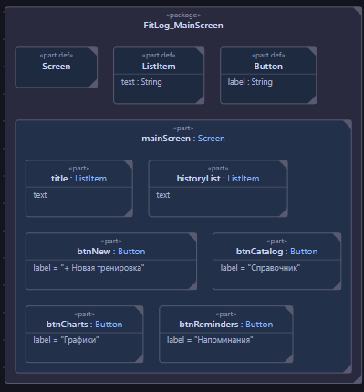
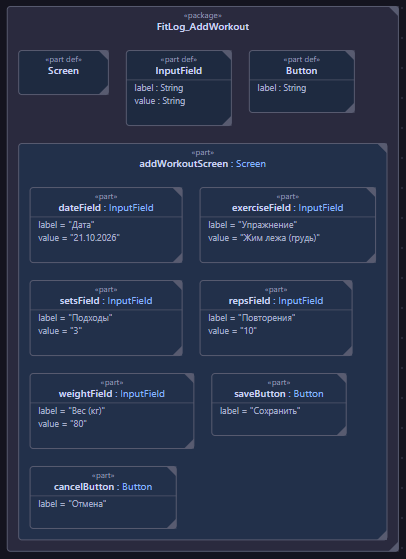
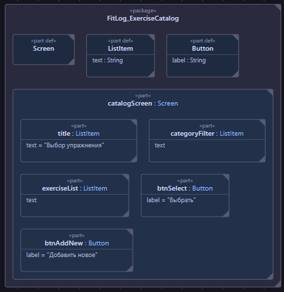
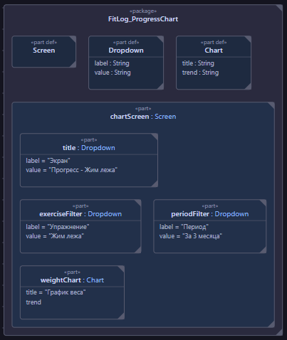
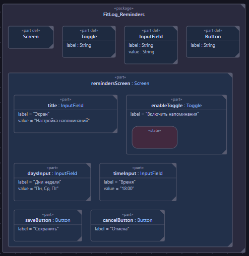

# Спецификация требований к ПО (SRS) — FitLog

**Версия:** 0.1  
**Подготовил(а):** Студент группы [450504]  
**Организация:** БГУИР, кафедра [ЭВМ]  
**Дата изменения:** 21.10.2026

## Оглавление

* [1. Введение](#1-introduction)
    * [1.1 Назначение документа](#11-document-purpose)
    * [1.2 Область применения продукта](#12-product-scope)
    * [1.3 Определения, акронимы и сокращения](#13-definitions-acronyms-and-abbreviations)
    * [1.4 Ссылки](#14-references)
    * [1.5 Обзор документа](#15-document-overview)
* [2. Обзор продукта](#2-product-overview)
    * [2.1 Перспектива продукта](#21-product-perspective)
    * [2.2 Функции продукта](#22-product-functions)
    * [2.3 Ограничения продукта](#23-product-constraints)
    * [2.4 Характеристики пользователей](#24-user-characteristics)
    * [2.5 Допущения и зависимости](#25-assumptions-and-dependencies)
    * [2.6 Распределение требований](#26-apportioning-of-requirements)
* [3. Требования](#3-requirements)
    * [3.1 Внешние интерфейсы](#31-external-interfaces)
        * [3.1.1 Пользовательские интерфейсы](#311-user-interfaces)
    * [3.2 Функциональные требования](#32-functional)
    * [3.3 Качество обслуживания](#33-quality-of-service)
    * [3.4 Соответствие стандартам](#34-compliance)
    * [3.5 Проектирование и реализация](#35-design-and-implementation)
    * [3.6 ИИ/МО](#36-aiml) *(Не применимо)*
* [4. Верификация](#4-verification)
* [5. Приложения](#5-appendixes)

## История изменений

| Name | Date | Reason For Changes | Version |
|------|------|--------------------|---------|
| Студент | 21.10.2026 | Первоначальная разработка бизнес-требований | 0.1 |

---

## 1. Введение

### 1.1 Назначение документа
Данный документ описывает бизнес-требования и границы приложения **FitLog**. Документ предназначен для команды разработки, тестировщиков и заказчика, чтобы синхронизировать понимание того, что именно должна делать система (без описания того, как это будет запрограммировано).

### 1.2 Область применения продукта
**FitLog** — это Desktop-приложение (Java 17, JavaFX) для ведения дневника тренировок. Основная цель — помочь пользователю отслеживать прогресс и планировать нагрузку. Данные хранятся локально в формате JSON, без использования облачных сервисов и внешних API. Система предназначена для персонального использования.

### 1.3 Определения, акронимы и сокращения

| Term | Definition |
|------|------------|
| FitLog | Название разрабатываемого приложения |
| Desktop | Приложение, устанавливаемое на персональный компьютер (ПК) |
| JSON | JavaScript Object Notation — текстовый формат обмена данными |
| GUI | Graphical User Interface — графический интерфейс пользователя |

### 1.4 Ссылки
- Шаблон SRS из репозитория BSUIR-SDLC/SDLC (файл `srs-template.md`).
- СТП БГУИР (Стандарт предприятия по оформлению документов).

### 1.5 Обзор документа
Документ содержит обзор продукта (раздел 2), детальные требования (раздел 3), включая функциональные и нефункциональные аспекты, а также таблицу верификации (раздел 4).

---

## 2. Обзор продукта

### 2.1 Перспектива продукта
Приложение является самостоятельным продуктом, не требующим подключения к сети Интернет. Данные хранятся в локальных файлах JSON на компьютере пользователя.

### 2.2 Функции продукта
1. Ведение записей о тренировках (упражнения, подходы, вес, даты).
2. Использование справочника упражнений с категориями.
3. Просмотр истории тренировок.
4. Визуализация прогресса (графики).
5. Настройка напоминаний.

### 2.3 Ограничения продукта
- **Язык разработки:** Java 17+.
- **Библиотека GUI:** JavaFX.
- **Хранение данных:** Локальные JSON-файлы.
- **Отсутствие сетевого взаимодействия:** Приложение не использует внешние сервисы, не синхронизируется с облаком и не имеет социальных функций.

### 2.4 Характеристики пользователей
- **U-1 (Новичок):** Пользователь, который только начал тренироваться. Ему важна простота ввода данных и мотивация через графики прогресса.
- **U-2 (Опытный атлет):** Пользователь, которому важно планировать нагрузку и отслеживать объем (тоннаж).
- **U-3 (Тренер):** Опциональная роль, просматривающая динамику клиента (вынесено в Backlog, вне v1).

### 2.5 Допущения и зависимости
- Предполагается, что пользователь имеет базовые навыки работы с компьютером.
- Предполагается, что на ПК установлена Java Runtime Environment (JRE) 17 или выше.

### 2.6 Распределение требований
Требования разделены на **Must have** (обязательные для первой версии) и **Could have** (желательные, отложенные на следующие версии). См. раздел 3.2.

---

## 3. Требования

### 3.1 Внешние интерфейсы

#### 3.1.1 Пользовательские интерфейсы
Интерфейс реализуется на JavaFX. Основные экраны (см. мокапы в Приложении 5):
- Главный экран (список тренировок).
- Экран добавления тренировки.
- Справочник упражнений.
- Экран графиков прогресса.
- Экран настроек напоминаний.

### 3.2 Функциональные требования

*Формат ID: REQ-[AREA]-[NNN]*

**Must have (v1.0):**

| ID | Title | Statement | Rationale | Acceptance Criteria |
|----|-------|-----------|-----------|---------------------|
| **REQ-FUNC-001** | Ведение записей о тренировке | Система должна позволять создавать запись о тренировке, указывая упражнение, подходы, повторения, вес и дату. | Основная функция (BG-1, BG-2). | Запись сохраняется и отображается в истории. |
| **REQ-FUNC-002** | Справочник упражнений | Система должна предоставлять справочник упражнений с категориями (грудь, спина, ноги и т.д.) и возможностью выбора. | Ускоряет ввод данных, снижает барьер (BG-1). | Пользователь выбирает упражнение из списка при создании записи. |
| **REQ-FUNC-003** | Просмотр истории | Система должна отображать историю тренировок с возможностью фильтрации по дате и упражнению. | Для анализа предыдущих результатов (BG-1, BG-2). | Список тренировок отображается корректно, фильтры работают. |
| **REQ-FUNC-004** | График прогресса | Система должна строить линейный график изменения рабочего веса во времени для выбранного упражнения. | Мотивация и визуализация прогресса (BG-1). | График строится на основе сохраненных данных. |
| **REQ-FUNC-005** | Напоминания | Система должна позволять настраивать напоминания о тренировках (дни недели и время). | Борьба с пропусками (BG-1). | Напоминание срабатывает в заданное время. |

**Could have (v2.0 и далее):**

| ID | Title | Statement |
|----|-------|-----------|
| **REQ-FUNC-006** | Шаблоны тренировок | Система должна позволять сохранять и запускать шаблоны тренировок (программ дня). |
| **REQ-FUNC-007** | График объема | Система должна строить график общего объема за неделю (подходы × повторения × вес). |
| **REQ-FUNC-008** | Напоминание о пропуске | Система должна отправлять уведомление, если пользователь не тренировался более 7 дней. |
| **REQ-FUNC-009** | Экспорт/Импорт | Система должна поддерживать экспорт и импорт данных в формат CSV для резервного копирования. |
| **REQ-FUNC-010** | Обработка пустых данных | Система должна отображать заглушку (Empty State), если для выбранного упражнения нет данных для построения графика. | Замечание напарника. | Заглушка отображается корректно. |
### 3.3 Качество обслуживания

- **REQ-PERF-001 (Производительность):** Приложение должно запускаться не дольше 3 секунд на ПК со средними характеристиками.
- **REQ-SEC-001 (Безопасность/Приватность):** Данные о тренировках хранятся исключительно в локальных файлах JSON на ПК пользователя. Передача данных по сети запрещена.
- **REQ-REL-001 (Надежность):** Приложение не должно терять данные при внезапном закрытии (автосохранение при каждом изменении).

### 3.4 Соответствие стандартам
Не применимо для v1.0 (локальное приложение без регулирования).

### 3.5 Проектирование и реализация
- **REQ-PORT-001 (Переносимость):** Приложение должно работать на ОС Windows, Linux и macOS при наличии установленной Java 17+.
- **REQ-MAINT-001 (Сопровождаемость):** Код должен быть модульным, с четким разделением GUI (JavaFX) и логики работы с JSON.

### 3.6 ИИ/МО
*Не применимо. В текущей версии приложения FitLog не используются алгоритмы машинного обучения или искусственного интеллекта.*

---

## 4. Верификация

| Requirement ID | Verification Method | Test/Artifact Link | Status | Evidence |
|----------------|---------------------|--------------------|--------|----------|
| REQ-FUNC-001 | Demonstration | mockups/add-workout.png | Planned | |
| REQ-FUNC-004 | Test | N/A | Planned | |
| REQ-FUNC-005 | Demonstration | mockups/reminders.png | Planned | |

---

## 5. Приложения

### 5.1 Отклоненные пожелания и границы (Out of Scope)

| Пожелание / Функция | Решение | Обоснование |
|---------------------|---------|-------------|
| **Мультипрофиль / Роль тренера** | В Backlog | Требует серверной части и синхронизации. В v1.0 — только один локальный профиль. |
| **Автоподсказка веса** | Отклонено | Требует сложных алгоритмов и внешних данных, выходит за рамки v1.0. |
| **Темная тема** | Отклонено из бизнес-требований | Является UI-требованием, а не бизнес-целью. Может быть реализовано на этапе дизайна. |
| **Голосовой ввод подходов** | Отклонено | Высокая сложность реализации, не оправдана на старте проекта. |

### 5.2 Мокапы GUI (SysMLv2)
### 5.2 Мокапы GUI (SysMLv2)

Код моделей интерфейса на языке SysMLv2 находится в папке `srs/sysml/`.
Визуализация интерфейса:

**Главный экран:**

**Экран добавления тренировки:**

**Справочник упражнений:**

**График прогресса:**

**Напоминания:**
